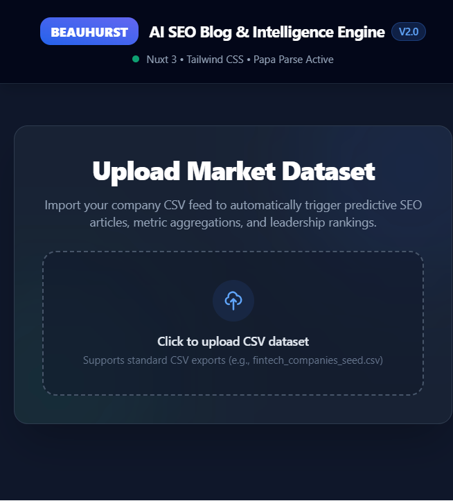
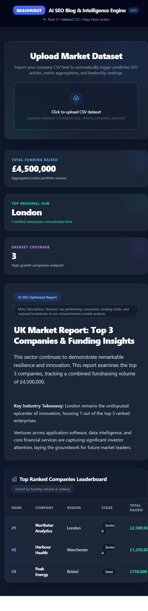

# Beauhurst AI SEO Blog & Intelligence Engine

A Nuxt application that turns a company funding CSV into an SEO-ready market
report. The app runs entirely in the browser: it parses the uploaded file,
calculates funding and regional statistics, and displays a generated article
with a company leaderboard.

## Live demo

Try the deployed application at
[beauhurst-seo-blog.vercel.app](https://beauhurst-seo-blog.vercel.app/).

## Screenshots

### Upload market dataset



### Generated market report



The report screenshot uses sample CSV data to demonstrate the generated
metrics, SEO article, and company leaderboard.

## Features

- Upload a company dataset in CSV format.
- Calculate total funding raised across all uploaded companies.
- Identify the region with the most companies.
- Generate a market report title, introduction, meta description, and commentary.
- Display the uploaded companies in a ranked leaderboard.
- Open each company website from the leaderboard.
- Responsive dark dashboard styled with Tailwind CSS.

## Tech stack

- [Nuxt 4](https://nuxt.com/)
- [Vue 3](https://vuejs.org/)
- [Tailwind CSS](https://tailwindcss.com/) via `@nuxtjs/tailwindcss`
- [Papa Parse](https://www.papaparse.com/) for client-side CSV parsing

## Requirements

- Node.js 20.19+ or 22.12+
- npm

## Setup

Install the project dependencies:

```bash
npm install
```

## Run locally

Start the Nuxt development server:

```bash
npm run dev
```

Open [http://localhost:3000](http://localhost:3000) in your browser.

If port `3000` is already in use, stop the existing Nuxt process or start the
development server on another port:

```bash
npm run dev -- --port 3001
```

## CSV format

The uploaded file should contain a header row with these columns:

| Column | Description |
| --- | --- |
| `Rank` | Company ranking shown in the leaderboard |
| `Company` | Company name |
| `Region` | Company location or regional hub |
| `Stage` | Funding or business stage |
| `Total Raised` | Funding amount, such as `£1,250,000` |
| `Website` | URL opened by the leaderboard link |

Example:

```csv
Rank,Company,Region,Stage,Total Raised,Website
1,Example Technologies,London,Series A,"£1,250,000",https://example.com
```

## Available scripts

| Command | Description |
| --- | --- |
| `npm run dev` | Start the development server |
| `npm run build` | Build the application for production |
| `npm run preview` | Preview the production build locally |
| `npm run generate` | Generate a static version of the application |

## Production

Create a production build:

```bash
npm run build
```

Preview the production build locally:

```bash
npm run preview
```

## Project structure

```text
app/
  app.vue              # Root Nuxt application shell
  pages/
    index.vue          # Upload interface and report dashboard
public/                # Static public assets
nuxt.config.ts         # Nuxt and Tailwind configuration
package.json           # Dependencies and npm scripts
```

## Notes

- CSV processing is performed locally in the browser; files are not uploaded
  to a server by this application.
- The report commentary is generated from the uploaded data using the
  application’s built-in templates. No external AI API is required.
